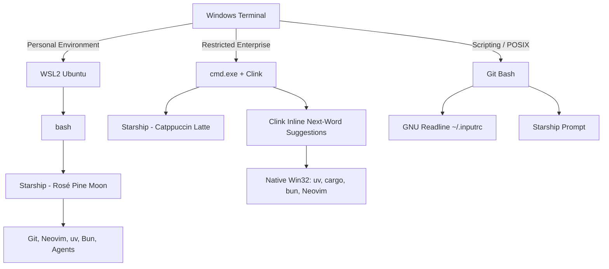

# Agentic Dotfiles

Reusable shell, Git, Neovim, Starship, and agent directives for both Ubuntu WSL2 and restricted Windows enterprise workstations.



Keep active repositories inside their target filesystem:
Inside WSL (`~/src`) when working in WSL2, or on native Windows drives (`C:\Work`) when working in the restricted enterprise setup.
This avoids cross-filesystem path, permissions, file-watch, and process-tree problems.
## Layout

```text
dotfiles/
├── .config/
│   ├── git/
│   ├── nvim/
│   └── starship/
├── agents/
│   ├── AGENTS.md
│   ├── CLAUDE.md
│   └── skills-audit.md
├── scripts/
│   ├── install-wsl.sh
│   ├── setup-agent-links.sh
│   ├── setup-git.sh
│   ├── setup-shell.sh
│   └── test-env.sh
├── windows/
│   ├── .config/
│   │   ├── clink/
│   │   └── starship/
│   ├── scripts/
│   │   └── setup-windows.cmd
│   ├── terminal/
│   │   ├── .bashrc
│   │   ├── .inputrc
│   │   └── settings.json
│   └── README.md
└── README.md
```

## Install in WSL2

Run these commands inside Ubuntu WSL2:

```bash
cd /mnt/d/Dev/dotfiles
chmod +x scripts/*.sh
./scripts/install-wsl.sh
```

For best repository performance, clone application repositories into `~/src`.
The dotfiles repository may remain on the Windows drive while it is being migrated.

The installer configures Git, global agent directives, bash, Starship, Neovim, and the WSL package prerequisites.
It installs `jq` because Firstmate and the AXI tools use it for structured automation output.
It installs `mise` only as a runtime manager, not as a wrapper around agent processes.

## Agent tools

Install Herdr, Pi, Treehouse, and the selected agent CLIs inside WSL2 after the base setup.
Use each project's current Linux installation instructions rather than Windows binaries.
Launch agents directly from the WSL shell so their paths, process ancestry, sockets, and workspaces share one Linux environment.

The AXI tools remain useful for Windows automation and are also supported inside WSL2:

- `gh-axi` for GitHub operations.
- `chrome-devtools-axi` for browser automation.
- `lavish-axi` for visual review artifacts.
- `quota-axi` for quota evidence.
- `tasks-axi` for backlog operations.
- `no-mistakes` for validation pipelines.

Install these tools in the environment that will execute them.
Do not mix Windows and WSL installations for one agent session.

## Retained tools

Keep Windows Terminal, GitHub CLI, Copilot CLI, Agy CLI, Bun, uv, Starship, and the AXI tools available on Windows when an IDE or automation workflow still uses them.
Keep the native Codex and Claude applications until their WSL replacements are verified.

## Validation

```bash
./scripts/test-env.sh
```

The check distinguishes required WSL tools from optional agent and AXI tools.

## Native Windows Workstation (Restricted Enterprise)

For corporate/enterprise Windows laptops operating under AppLocker, WDAC, proxy, and Constrained Language Mode without WSL.

See [`windows/README.md`](windows/README.md) for detailed architecture and security policy background.

### Quick Install on Windows

Run the automated installer from Command Prompt:

```cmd
cd windows\scripts
setup-windows.cmd
```

Features configured:
- **Primary shell**: `cmd.exe` with portable Clink (0 ms typing latency, native Win32 execution).
- **Inline ghost text**: Next-word suggestions via `Ctrl+Right` and full accept via `Right Arrow`.
- **Starship prompt**: Catppuccin-Powerline Latte theme with native UTF-8 glyph rendering.
- **Git Bash**: Clean `~/.bashrc` and `~/.inputrc` for instant word navigation and history search.
- **Neovim**: Portable user-space installation with the Rosé Pine Moon config from `.config/nvim/init.lua`.
