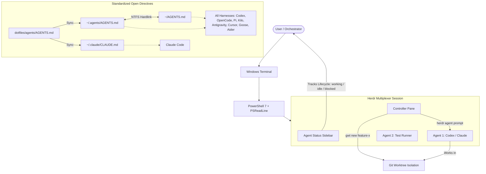

# Agentic Dotfiles for Windows 11 (L8 Principal Setup)

Reproducible, agent-native development environment tailored for Windows 11, PowerShell 7, Windows Terminal, and the **Herdr** agent multiplexer.
Ported from Kun Chen's Principal Engineer workflow (`5N-okeDdIuI`, `kPN564Kol14`).

```
dotfiles/
├── .config/
│   ├── git/
│   │   ├── .gitconfig
│   │   └── .gitignore_global
│   ├── herdr/
│   │   └── config.toml
│   ├── nvim/
│   │   └── init.lua
│   └── starship/
│       └── starship.toml
├── agents/
│   ├── AGENTS.md
│   └── CLAUDE.md
├── powershell/
│   ├── Microsoft.PowerShell_profile.ps1
│   └── modules/
│       ├── AgentWorktree.psm1
│       ├── HerdrTools.psm1
│       └── WTBackdrop.psm1
├── scripts/
│   ├── install.ps1
│   ├── setup-agent-links.ps1
│   ├── setup-git.ps1
│   ├── setup-herdr.ps1
│   ├── setup-profile.ps1
│   ├── setup-starship.ps1
│   ├── setup-terminal.ps1
│   ├── sync.ps1
│   └── test-env.ps1
└── windows-terminal/
    ├── settings.json
    └── schemes/
        └── rose-pine-moon.json
```

## Architecture & Minimal Directives Topology



## Recommended Tooling & Ecosystem (Kun Chen Stack)

### 1. Agent Multiplexing & Orchestration
- **Herdr**: Agent-native terminal multiplexer in Rust that tracks live agent lifecycle states (`working`, `idle`, `blocked`, `done`), session persistence, and programmatic socket APIs.
- **First Mate**: Captain-and-crew orchestrator for delegating tasks to subagent panes across multiplexer workspaces.
- **GNHF** ("Good Night, Have Fun"): Asynchronous goal orchestrator for autonomous overnight agent task execution.

### 2. Worktree & Context Isolation
- **Treehouse** / **`New-AgentWorktree`** (`gwt`): Git worktree automation for creating isolated branch workspaces per task to prevent dirty working trees.
- **Global `AGENTS.md`**: Standardized system instruction specification (Agentic AI Foundation) establishing deterministic, token-efficient agent behavior.

### 3. Agent eXperience Interface (AXI) Tools
- **No-Mistakes**: Local git pre-push validation proxy that runs AI agents to lint, review, and test code before remote push.
- **Lavish-AXI**: Local artifact visualizer for rapid interactive UI review.
- **Quota-AXI**: Unified CLI tracker for multi-provider LLM rate limits and token windows.

### 4. Modern CLI & Terminal Utilities
- **Starship**: Blazing fast, minimal cross-shell prompt (`winget install Starship.Starship`).
- **Zoxide**: Smarter `cd` command with frecency jumping (`winget install ajeetdsouza.zoxide`).
- **Fzf**: Interactive command-line fuzzy finder (`winget install junegunn.fzf`).
- **Eza**: Modern replacement for `ls` with file icons, git status, and tree views (`winget install eza-community.eza`).
- **Bat**: Syntax-highlighted `cat` replacement (`winget install sharkdp.bat`).
- **Delta**: Syntax-highlighting git diff pager (`winget install dandavison.delta`).
- **Lazygit**: Fast terminal UI for git (`winget install JesseDuffield.lazygit`).
- **Btop**: Terminal resource monitor for CPU, GPU, RAM (`winget install aristocratos.btop4win`).

### 5. Package Managers & Runtimes
- **UV**: Ultra-fast Python package resolver and runner (`winget install astral-sh.uv`).
- **Bun**: Fast JavaScript runtime, bundler, and test runner (`powershell -c "irm bun.sh/install.ps1 | iex"`).

### 6. Neovim Agentic Configuration
- **Neovim (v0.11+)**: Configured with native `vim.lsp.config`, `vim.lsp.enable`, and `LspAttach` autocommands.
- **Oil.nvim**: File explorer that edits directories like regular text buffers.
- **Telescope.nvim**: Fuzzy finder for files, ripgrep searches, and LSP symbols.
- **Treesitter**: Fast AST-based syntax highlighting and indentation.
- **Which-Key.nvim**: Real-time visual keybinding popup.

## Installation & Deployment

Run from PowerShell 7:

```powershell
# One-shot idempotent installation
pwsh .\scripts\install.ps1

# Sync live configs into repository
pwsh .\scripts\sync.ps1

# Deploy / Refresh global agent directives
pwsh .\scripts\setup-agent-links.ps1

# Run diagnostic verification
pwsh .\scripts\test-env.ps1
```

## Keybindings & Shortcuts

### Herdr (`ctrl+a` prefix)
| Keybinding | Action |
| :--- | :--- |
| `ctrl+a` + `v` | Split pane vertically |
| `ctrl+a` + `-` | Split pane horizontally |
| `ctrl+a` + `h/j/k/l` | Navigate panes (Vim-style) |
| `ctrl+a` + `z` | Zoom / Fullscreen active pane |
| `ctrl+a` + `b` | Toggle agent sidebar |
| `ctrl+a` + `c` | Create new tab |
| `ctrl+a` + `w` | Workspace picker |
| `ctrl+a` + `Shift+G` | New Git worktree in Herdr |
| `ctrl+a` + `Shift+R` | Reload `config.toml` |
| `ctrl+a` + `q` | Detach session |

### PowerShell & Agent Workflow Commands
| Command | Alias | Description |
| :--- | :--- | :--- |
| `Start-HerdrSession` | `h` | Launch / attach to Herdr |
| `Get-HerdrStatus` | `hs` | Show Herdr client & server status |
| `Get-HerdrAgents` | `hla` | List live agents and their lifecycle state |
| `Start-HerdrAgent` | `hstart` | Split pane & spawn named agent (`hstart reviewer codex`) |
| `Send-HerdrPrompt` | `hprompt` | Submit prompt to named agent (`hprompt reviewer "review diff" -Wait`) |
| `New-AgentWorktree` | `gwt` | Create isolated git worktree branch for agent task |
| `Get-AgentWorktrees` | `gwtl` | List active git worktrees |
| `Remove-AgentWorktree`| `gwtrm` | Safely remove worktree |
| `Sync-AgentDirectives`| `sync-agents` | Re-sync minimalist global directives |
| `Set-WTBackdrop` | `backdrop`, `tb` | Toggle Windows Terminal acrylic / mica / solid backdrop |
